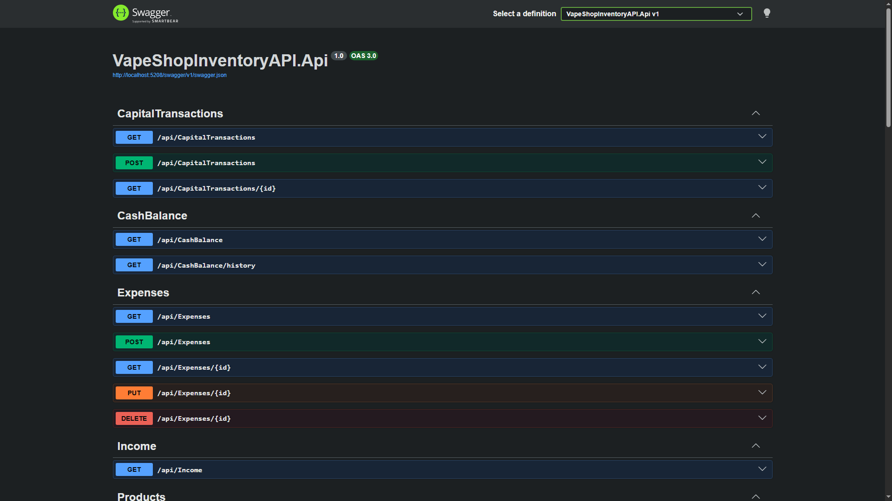
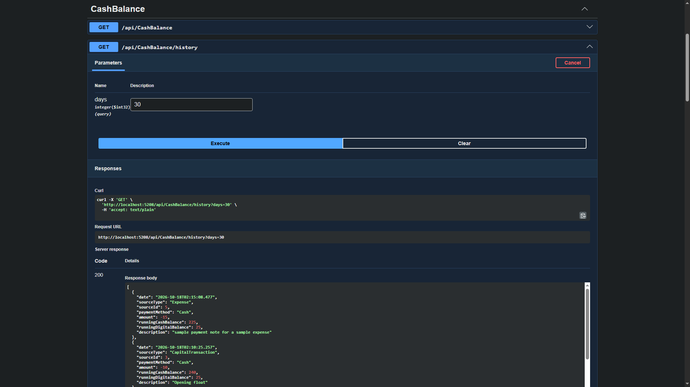

# Vape Shop Inventory API

[](https://github.com/dreckieee/VapeShopInventoryAPI/actions/workflows/ci.yml)

ASP.NET Core Web API that runs the inventory, sales and cash tracking of a real vape shop. Built and shipped end to end: EF Core + SQLite, 108 automated tests, GitHub Actions CI, and a live deployment on a DigitalOcean droplet.

## Screenshots



## What it does
- Products, expenses, and sales with line items (stock is deducted when a sale is closed)
- Restock deliveries: one invoice, many products, one computed expense
- Receivable/Payable tracking: settlements record payments against open balances
- Owner deposits and withdrawals, kept separate from expenses so they never distort income
- Cash balance (cash, digital, receivables, payables) and a windowed history with running balances

## Design highlights
- Derived values (sale total, outstanding balance, low-stock flag, cash balances) are computed, never stored, so they cannot drift out of sync.
- Ledger records (settlements, capital transactions) are immutable by design: no edit or delete endpoint.
- Invalid input returns `400`; deleting or editing a record that other records depend on returns `409` with a clear message.
- Tests run against an isolated in-memory SQLite database. Sign, branch and window-boundary logic was mutation-checked: the logic was broken on purpose to confirm the tests fail.
- Design rationale, trade-offs and rejected alternatives: [DECISIONS.md](./DECISIONS.md)

## Tech stack
- .NET 10 / ASP.NET Core (Controllers)
- Entity Framework Core + SQLite
- NUnit + `WebApplicationFactory`
- GitHub Actions (CI)
- Postman (API checks)

## Run locally
Requires the .NET 10 SDK.

```
git clone https://github.com/dreckieee/VapeShopInventoryAPI.git
cd VapeShopInventoryAPI/VapeShopInventoryAPI.Api
dotnet tool install --global dotnet-ef
dotnet ef database update
dotnet run
```

`dotnet ef database update` creates the local SQLite database from the migrations (skip the tool install if `dotnet-ef` is already installed). Run both `dotnet ef` and `dotnet run` from the `VapeShopInventoryAPI.Api` folder so they use the same database file.

Then open `http://localhost:{port}/swagger` (the port is printed in the terminal).

## Endpoints

| Area | Endpoints | Notes |
|---|---|---|
| Products | `GET/POST /api/Products`, `GET/PUT/DELETE /api/Products/{id}` | Filter with `?name=` and `?category=`. Delete returns `409` if the product is referenced. |
| Sales | `GET/POST /api/Sales`, `GET/PUT /api/Sales/{id}`, `POST /api/Sales/{id}/close`, `PUT /api/Sales/{id}/cancel` | Filters: `year`, `month`, `isClosed`, `paymentMethod`. Stock deducts on close. |
| Sale items | `POST /api/Sales/{saleId}/items`, `PATCH /api/Sales/{saleId}/items/{itemId}/reduce` | Rejected once the sale is closed. |
| Expenses | `GET/POST /api/Expenses`, `GET/PUT/DELETE /api/Expenses/{id}` | Filters: `year`, `month`, `paymentMethod`. Restock- and settlement-linked records are protected (`409`). |
| Restock | `POST /api/restock` | Batch delivery: line items roll up into one expense and per-line delivery records. |
| Settlements | `GET/POST /api/Settlements`, `GET /api/Settlements/{id}` | Payments against Receivable/Payable records. Immutable. |
| Capital transactions | `GET/POST /api/CapitalTransactions`, `GET /api/CapitalTransactions/{id}` | Owner deposits/withdrawals. Immutable. |
| Income | `GET /api/income` | Closed sales only; `year` and `month` optional. |
| Cash balance | `GET /api/cashbalance`, `GET /api/cashbalance/history?days=` | History: `days` required (1-366, `1` = today only). Returns `[]` if nothing falls in the window; use `GET /api/cashbalance` for the current balance. |

Sale and expense responses include computed `TotalAmount`, `AmountSettled` and `OutstandingBalance`.

## Testing
108 NUnit tests using `WebApplicationFactory<Program>` against an isolated in-memory SQLite database. No separate server is needed.

```
dotnet test
```

GitHub Actions builds and runs the full suite on every push and pull request to `main`. Known coverage gaps are tracked in [DECISIONS.md](./DECISIONS.md).

### Postman collection (in progress)
A Postman collection for manual API checks is in `postman/VapeShopInventoryAPI.postman_collection.json`. It targets the local API only, never the live server.

1. Start the API (see [Run locally](#run-locally)).
2. In Postman, choose Import and select the collection file.
3. Check the collection variable `baseUrl`: it should be `http://localhost:5208`. If the terminal prints a different port, change `baseUrl` to match.
4. Run the requests in this order:
   1. `POST Products` creates a product with a unique SKU and saves `productId` and `productSku` as collection variables.
   2. `GET Products/{productId}` reads that product back.
   3. `POST Products (duplicate Sku)` sends the same SKU again.
   4. Four negative requests, `POST Products (...)`, follow. They are independent of the others.

The order matters because steps 2 and 3 use the variables saved by step 1.

What the checks cover: status codes (`201`, `200`, `409`, `400`), the returned name, price and `isLowStock`, the returned id, and the duplicate-SKU message. The negative requests check that invalid product input returns `400`: negative stock, empty name, a missing required field, and a negative low-stock level.

## Live deployment
Runs as a systemd service on Ubuntu 24.04 (DigitalOcean, Singapore). Swagger is enabled in production for demos. There is no authentication, a deliberate scope choice for this portfolio project, so the live URL is not published. A live demo is available on request.

## About
Built while growing into software engineering, with a focus on QA and .NET. More of my work: [C# console apps](https://github.com/dreckieee/csharp), [Playwright + TypeScript tests (in progress)](https://github.com/dreckieee/toolshop-playwright-ts), [LinkedIn](https://linkedin.com/in/dreckieee)..